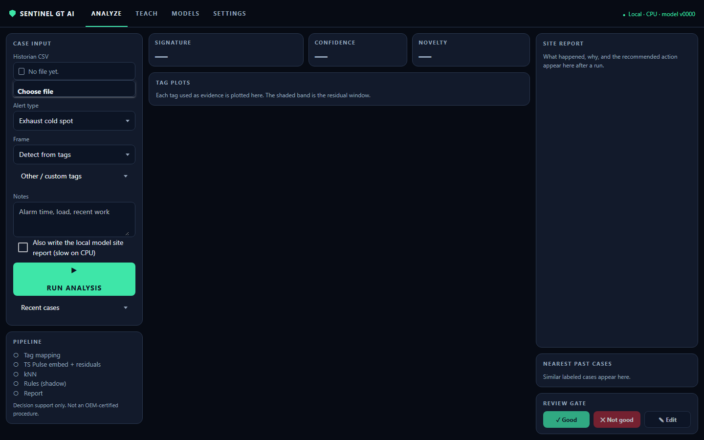
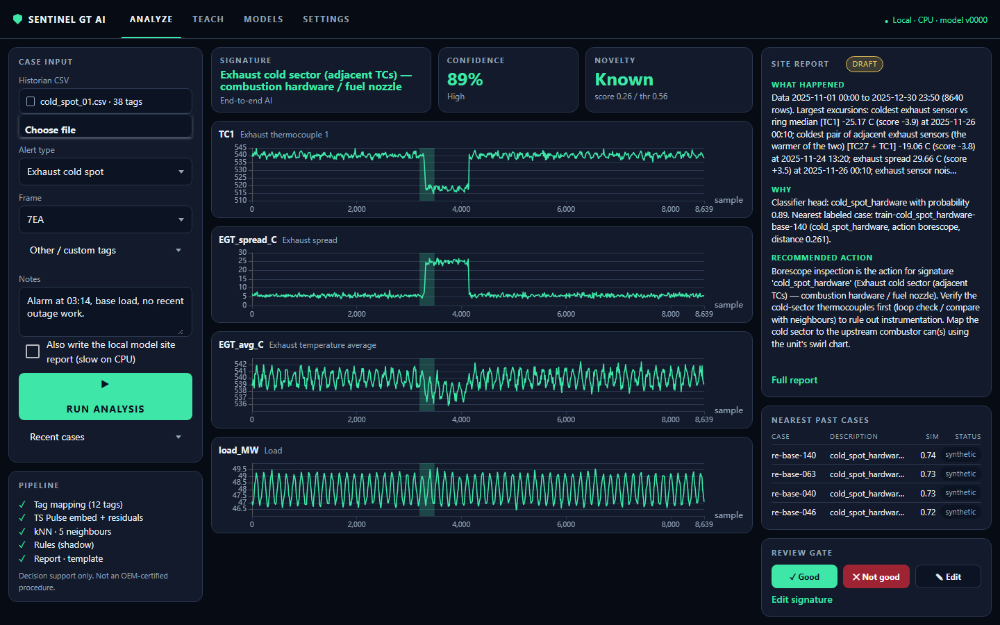
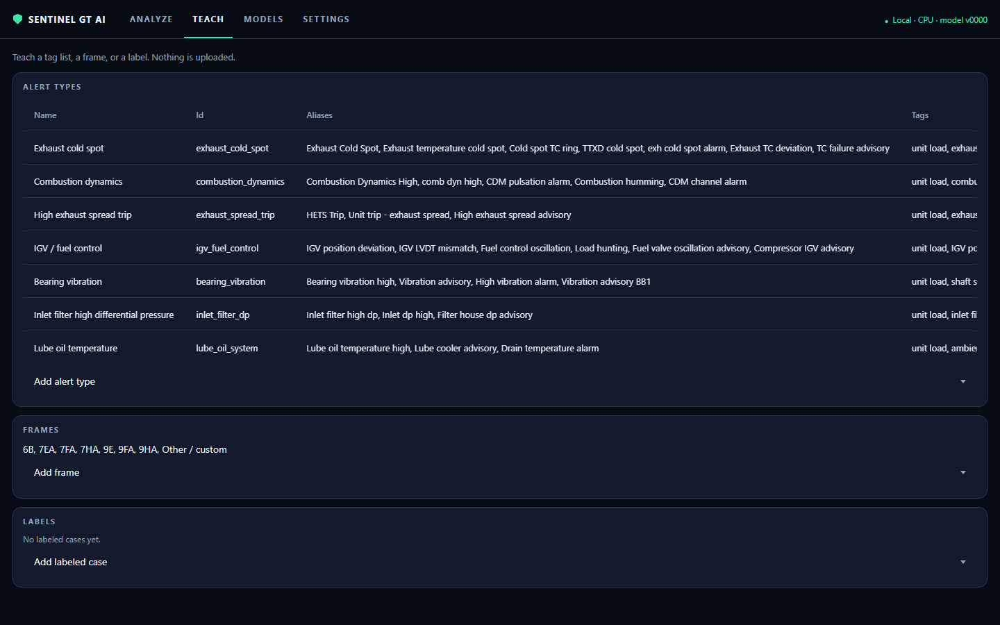
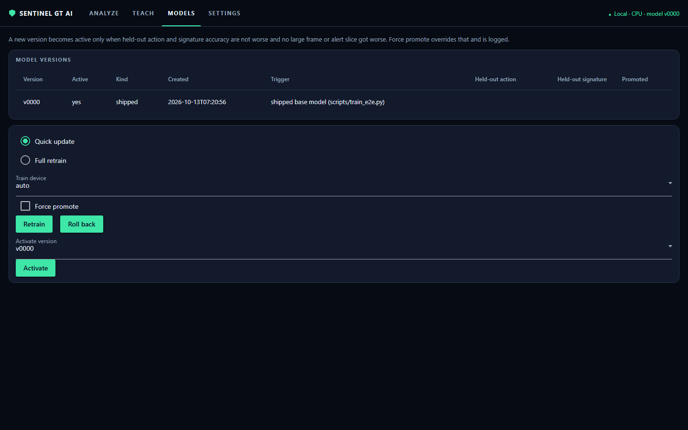
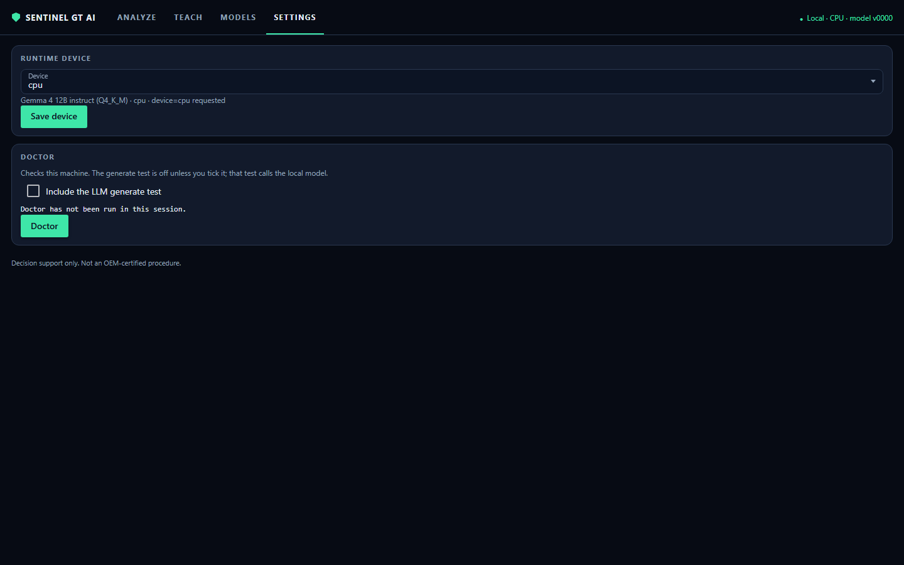

# Sentinel GT AI

A local assistant for a Tier 2 gas-turbine engineer. Drop in a historian CSV, the alert name, and your notes. The app drafts a site report with the evidence: a classifier, a second residual view, similar labeled cases, the rule shadow, and the process steps. You review it, correct it, and teach the app. Review and inference stay on this computer.

The learned path is the default. The rule path still runs beside it and is named in the report. If the language model is missing or fails its checks, the report uses a deterministic template.

## Features

- **Per-alert dynamic tag profiles.** Each alert type carries its own tag list, classifier head, similarity index, and novelty calibration. A file that omits a declared tag cannot outrun the coverage cap.
- **Alert types are not a fixed menu.** Seven types ship with the app. Add another from a sample CSV header, or from the Teach page. There is no built-in limit on how many you add.
- **Frame dropdown.** 6B, 7EA, 7FA, 7HA, 9E, 9FA, 9HA, and Other / custom. A frame added on Teach the app shows up in the same dropdown.
- **Teach page.** Labeled cases with a one-sentence why, process documents, new signatures, and new alert types. Labels enter the similarity index immediately.
- **Retrain with a not-worse gate.** Quick update refits the head. Full retrain fine-tunes the encoder, then refits the head. A new version is promoted only when held-out action and signature accuracy are not worse, and no large frame or alert slice got worse. Force promote is explicit and is written to the train log. One-click rollback.
- **CPU fallback.** Device `auto` uses the GPU when the CUDA build loads, and the CPU when it does not or runs out of memory. You can force CPU.
- **Fully local.** After install, review and inference do not use the network. `setup` and `install.ps1` are the commands that download.

## Architecture

Historian CSV, alert name, and notes go in. The app maps tags for the selected frame and alert type, embeds the window, scores the head and the nearest labeled cases, and runs a residual cross-check. Rules run in shadow. Process maps for that alert type go into the prompt. Gemma 4 12B writes the draft, or the template does. You mark it and, when you want, retrain.

```
CSV + alert name + notes
  -> frame and alert-type tag profile
  -> TS Pulse embedding + classifier head + similarity / novelty
  -> TS Pulse residual (or robust-z fallback)
  -> rules in shadow + process knowledge
  -> Gemma 4 12B, or the deterministic template
  -> draft report -> engineer review -> teach / retrain
```

The whole app is one commented file, `sentinel_gt_ai.py`. The `sentinel/` package re-exports those sections. Details are in [docs/ARCHITECTURE.md](docs/ARCHITECTURE.md).

## Screenshots

The dashboard is NiceGUI. These five images are the four pages, taken with synthetic samples. No plant export is in them.











## Quick start

Windows 11, Python 3.11. Full steps, GPU and CPU, are in [docs/INSTALL.md](docs/INSTALL.md). Day-to-day use is in [docs/USER_GUIDE.md](docs/USER_GUIDE.md).

```powershell
powershell -ExecutionPolicy Bypass -File install.ps1
.venv\Scripts\python sentinel_gt_ai.py doctor
.venv\Scripts\python sentinel_gt_ai.py
```

`python sentinel_gt_ai.py` opens the NiceGUI dashboard at http://127.0.0.1:8501. The server listens on localhost only. `--port` changes the port. `--headless` starts the server without opening a browser. `--native` opens a desktop window when the optional `pywebview` package is installed. Vue, Quasar, and ECharts are served from the installed NiceGUI package. The dashboard makes no runtime network call for its own assets.

A clone starts with an empty case library (`data/` is not in git). The sample CSVs under `samples/` are synthetic. Teach from those, or from your own exports.

`python sentinel_gt_ai.py setup` is the same install from the single file (venv, packages, models, doctor).

## Using the UI

The header has four tabs: Analyze, Teach, Models, Settings. The right side of the header reads Local, the device, and the active model version. A longer walkthrough is in [docs/USER_GUIDE.md](docs/USER_GUIDE.md).

**Analyze.** The page is a three-column dashboard. Upload a historian CSV, pick the alert type and the frame, add notes, and press **Run analysis**. The frame list is auto (detect from tags), the shipped frames (6B, 7EA, 7FA, 7HA, 9E, 9FA, 9HA), frames taught on the Teach page, and Other / custom. Other / custom uses a tag layout or tags you type. The middle column shows signature, confidence, and novelty (Novel, Known, or Not scored), then one chart per evidence tag with the residual window shaded. The right column is the short site report (what happened, why, recommended action), nearest past cases, and the review gate: **Good**, **Not good**, and **Edit**. The full document opens from **Full report** and can be printed. The report stays a draft until that review. Print from the browser: the header and the form stay off the printed page.

**Teach.** Alert types with their tag lists, frames, and labels. Adding a labeled case loads the learned model. Retrain and rollback are on Models.

**Models.** Version table, **Retrain** (quick or full), and **Roll back**. A new version becomes active only when held-out action and signature accuracy are not worse and no large frame or alert slice got worse. Force promote overrides that and is logged. The page shows the promoted flag the trainer wrote. It does not recompute the gate.

**Settings.** Device is auto, gpu, or cpu. The choice is written to `settings.local.json` only when you press **Save device**. **Doctor** runs the same machine check as the CLI. The LLM generate test stays off unless you tick it.

A Good verdict becomes APPROVED. Not good becomes REJECTED and stores the corrected action. Similar future cases reuse that verdict: a correction on a closely similar case (similarity ≥ 0.80) changes the recommended action, and an approval raises confidence. Feedback also goes into the LLM prompt as examples.

## Status and results

On a **synthetic** held-out set of 320 cases, the per-alert heads scored:

| | Legacy head | Per-alert heads |
|---|---:|---:|
| Signature accuracy | 90.0% (288/320) | 95.3% (305/320) |
| False novelty | 1.3% (4/320) | 0.6% (2/320) |

The rows are generated scenarios, not a plant historian. Do not read the percentages as field accuracy. Two truth-signature slices were a few cases lower than the legacy head (dynamics probe fault, high-exhaust-spread trip hardware). Because of that slice gate, a fresh `settings.local.json` keeps `e2e_mode` at `legacy`. Set it to `peralert` when you want one head per alert type. Both modes are local.

## Layout

```
sentinel_gt_ai.py     the app (NiceGUI UI, CLI, setup, doctor, train)
app.py                same CLI
install.ps1           Windows install
sentinel/             import hooks for the sections in the single file
knowledge/            process maps used as model context
models/e2e/           shipped learned model (encoder, heads, indexes)
models/               Gemma 4 12B and TS Pulse, downloaded by install (not in git)
samples/              small synthetic CSVs
tests/                pytest
docs/                 install, user guide, architecture
data/                 cases and labels, created on this machine (not in git)
```

> Engineering decision support only. Not a certified procedure or a protection system. Site procedures and equipment limits take precedence.
